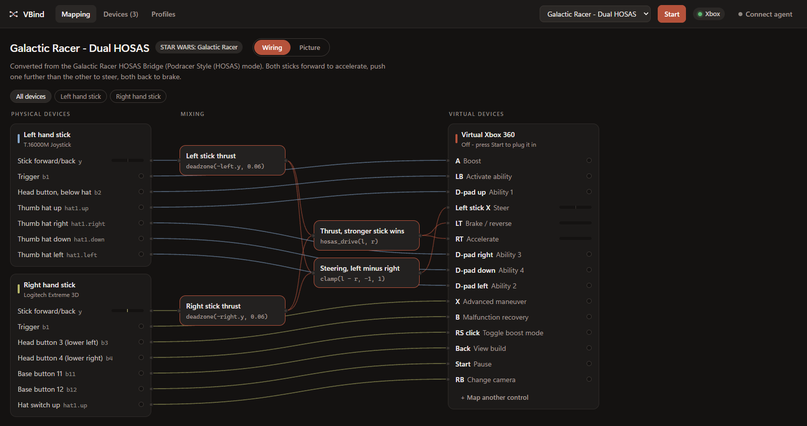
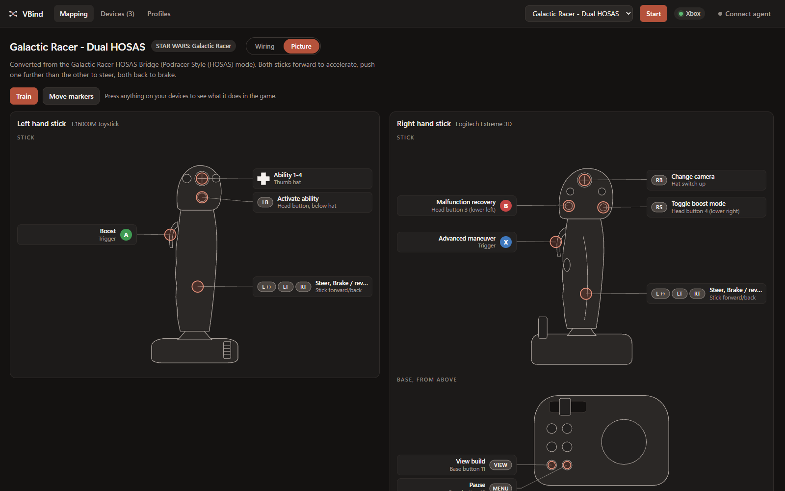
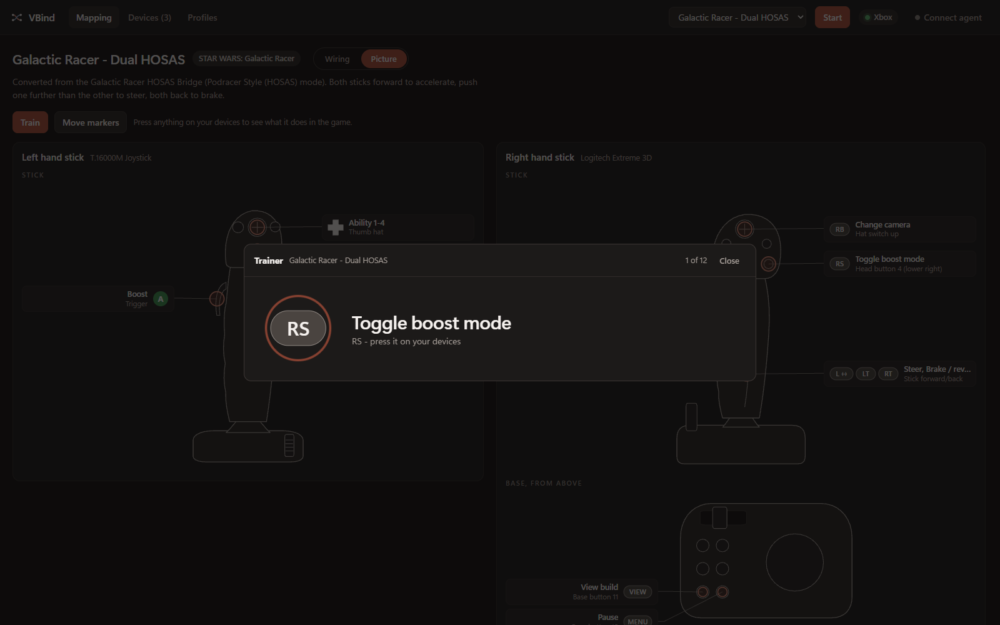

# VBind

**An agent-first controller mapper for Windows.** Plug in flight sticks,
throttles, wheels or pedals, tell your AI coding agent what you want, and VBind
turns them into a virtual Xbox 360 controller, a vJoy stick, or keyboard keys
and mouse movement, so they work in any game, including games with no
controller support at all.

VBind ships with no mappings. Your agent (Claude Code, Codex, Cursor, ...)
connects to it over MCP or the `vbind` CLI, finds your devices, asks you to
press controls, writes the mapping, tests it and shows its progress in the
VBind window. You watch and approve.

## Quick start

VBind is built from source by your coding agent. You need Windows 10/11 and an
agent that can run commands. Paste this into it:

> Clone https://github.com/LaneBirmingham/VBind, follow its
> docs/BUILDING.md to build and install VBind, then connect yourself to it
> over MCP. After that, use VBind to map my game controllers to a virtual Xbox
> controller for &lt;your game&gt;. Show me the plan in the VBind window first.

The agent installs the toolchain it needs (Rust, Node), builds the installer,
installs [ViGEmBus](https://github.com/nefarius/ViGEmBus/releases) for the
virtual Xbox pad (with your OK), and registers the MCP server. From then on
you just ask it for mappings in plain words.

## What you get

- **Wiring board** - every mapping live, from physical control through any
  mixing math to the virtual button it drives. Click anything to inspect or
  edit it.
- **Picture view** - drawings of your own devices with each control labelled by
  the game action it triggers ("A - Boost"). Controls light up as you press
  them. Your agent draws the devices; add a photo of your own if you like (it
  never leaves your PC).
- **Trainer** - shows a game button the way the game does and waits for you to
  press it on your sticks, so your hands learn what "Press A" means.
- **Joystick to keyboard and mouse** - map any button, hat or axis to key
  presses, mouse buttons, mouse movement or the scroll wheel, for games and
  actions that only take keyboard and mouse. Mix them freely with a virtual
  Xbox pad in the same profile.
- **Expressions, not just bindings** - deadzones, curves, mixing two sticks into
  one axis, shift layers, toggles and double-taps.
- **Portable profiles** - one JSON file per game, matching devices by USB id so
  it works on other PCs. Export and share.
- **Runs in the tray** - close the window and your mapping keeps running.

| Picture view | Trainer |
| --- | --- |
|  |  |

## Documentation

| Doc | For |
| --- | --- |
| [docs/BUILDING.md](docs/BUILDING.md) | Building, installing, drivers, project layout, tests |
| [docs/OVERVIEW.md](docs/OVERVIEW.md) | How VBind works: profiles, layouts, pictures, game integrations |
| [docs/AGENT_GUIDE.md](docs/AGENT_GUIDE.md) | The agent's reference (also served as `vbind guide` and over MCP) |

## Status

Early (v0.1). Tested with a Thrustmaster T.16000M and a Logitech Extreme 3D
Pro driving a virtual Xbox 360 controller. vJoy output is implemented but not
yet tested on real hardware. Windows only.

## License

[MIT](LICENSE)
