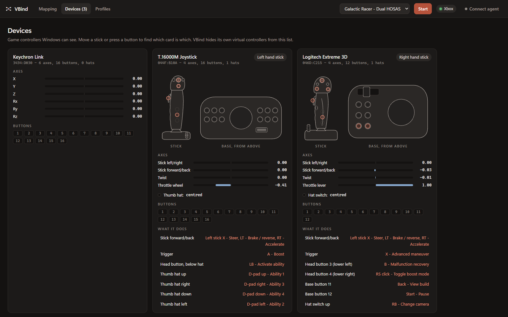

# How VBind works

VBind maps physical game controllers (flight sticks, throttles, wheels, pedals,
pads) to virtual devices on Windows: a virtual Xbox 360 controller, a vJoy
flight stick that merges several sticks into one device, the keyboard and
mouse, or a game integration.

It is agent-first: VBind ships with no mappings, and your AI agent does the
mapping work through MCP or the `vbind` CLI. The agent's full reference is
[AGENT_GUIDE.md](AGENT_GUIDE.md).

## The window

**Mapping** shows the profile on the board. **Wiring** draws every physical
control, the mixing math in between, and the virtual control it drives, all
live as you move your sticks. **Picture** shows the same mapping on drawings
of your devices.

**Devices** lists every controller Windows can see, with live axes and
buttons, the role each device plays in the current profile, and what each
control does in the game.



**Profiles** lists, imports and exports profiles. **Connect agent** gives
copy-ready commands for Claude Code, Codex and other MCP apps. The agent's
plan, questions and progress appear in a side panel while it works.

Closing the window keeps the mapping running from the tray; use Quit in the
tray menu to stop it.

## Profiles

A profile is one JSON file: device roles (matched by USB id or name, so it
works on other PCs), optional variables, and one expression per virtual
control:

```json
{
  "vbind": 1,
  "id": "two-sticks",
  "name": "Two sticks",
  "devices": {
    "left": { "label": "Left stick", "match": [{ "vid": "044F", "pid": "B10A" }] },
    "right": { "label": "Right stick", "match": [{ "vid": "046D", "pid": "C215" }] }
  },
  "outputs": { "pad": { "type": "xbox360" } },
  "vars": { "drive": "hosas_drive(deadzone(-left.y, 0.06), deadzone(-right.y, 0.06))" },
  "map": {
    "pad.rt": "max(drive, 0)",
    "pad.lt": "max(-drive, 0)",
    "pad.a": "left.b1"
  },
  "labels": { "pad.a": "Boost" }
}
```

Share a profile with **Export** on the Profiles tab; whoever imports it picks
their own devices for each role. `vbind schema profile` prints the full JSON
schema, and the expression language is documented in the
[agent guide](AGENT_GUIDE.md#expressions).

[`examples/profiles/galactic-racer-dual-hosas.vbind.json`](../examples/profiles/galactic-racer-dual-hosas.vbind.json)
is a complete two-stick HOSAS setup for STAR WARS: Galactic Racer, converted
from the Galactic Racer HOSAS Bridge with `vbind import hosas-bridge`.

## Layouts and pictures

A layout card names a device's controls ("Trigger" instead of "Button 1") and
holds the agent's drawings of it. VBind ships no device art: the agent draws
any device from a kit of generic parts and SVG paths, checks its drawing by
rendering it, and can line it up with your own photo, which stays on your PC.
Examples are in [`examples/layouts`](../examples/layouts). Layouts are shared
the same way as profiles; photos are never included.

The Picture view points every mapped control at the game button it drives
("A - Boost"), lights it up as you press it, and can carry a memory hint. The
**Trainer** shows a game button the way a game does and waits for you to press
it on your sticks; misses come back later in the round.

## Game integrations

Optional, per-PC add-ons for games without useful controller support. Where
someone has written a game-side plugin that takes input from outside (Kontrol
adapters, for example), an integration file tells VBind how to reach it
through shared memory; profiles then map sticks straight to the game's own
actions with full analog input.

VBind ships no integrations and nothing game-specific: your agent writes the
file, and VBind installs the plugin into the game only when you agree, shows
whether it is running, and removes it cleanly. See
[Game integrations](AGENT_GUIDE.md#game-integrations) in the agent guide.

## Where things live

| Path | What |
| --- | --- |
| `%LOCALAPPDATA%\VBind` | The installed app (`vbind-app.exe`) and CLI/MCP server (`vbind.exe`) |
| `%APPDATA%\VBind` | Profiles, device assignments, layouts, integrations, settings |
| `%APPDATA%\VBind\runtime.json` | Port and API token of the running engine |
